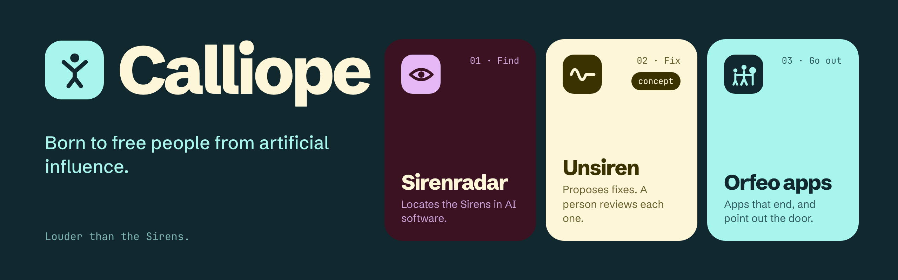
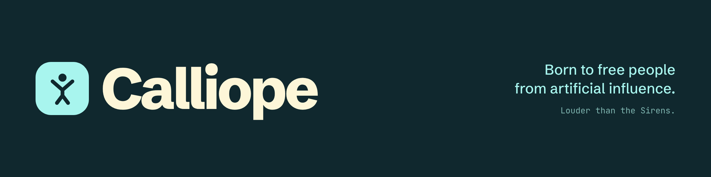
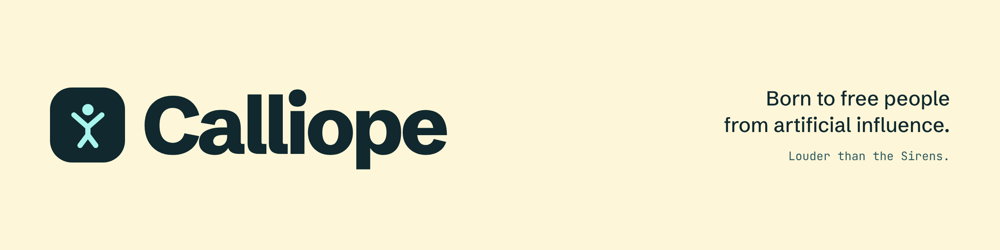
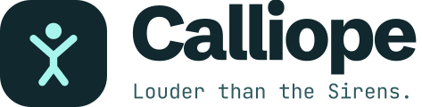

  

<!-- Minimal alternatives (pick one and delete the banner above):

<picture>
  <source media="(prefers-color-scheme: dark)" srcset="./assets/calliope-lockup-tagline-for-dark.svg">
  
</picture>
-->

**Calliope, born to free people from artificial influence.**

Some AI software is built to keep you there: it profiles you, pretends to be a person, or persuades without saying so. We call those techniques the Sirens. Calliope makes open tools that find them, is designing one to help fix them, and makes apps that help you put the phone down and go out.

### What we make

| | | |
|---|---|---|
| **01 · Find** | [**Sirenradar**](https://github.com/[ORG]/sirenradar) | Locates the Sirens in AI software. Helps teams prepare for the EU AI Act and other AI rules. Not legal advice, and never a score. Try it: `uvx aisafe audit .` |
| **02 · Fix** | [**Unsiren**](https://github.com/[ORG]/unsiren) · *concept* | Proposes fixes for what Sirenradar finds. A named person reviews every fix. |
| **03 · Go out** | **Orfeo apps** | Apps that end, and point out the door. [laiive](https://laiive.com): ask what is on tonight. [VaiVia](https://vaivia.dev): ask for a trail the way you would ask a local. |

### Calliope community

Everyone around Calliope. Its members, we call them Argonauts.

- Resources
- Work with us
- Partners
- Share what we do
- Be updated

Louder than the Sirens.
