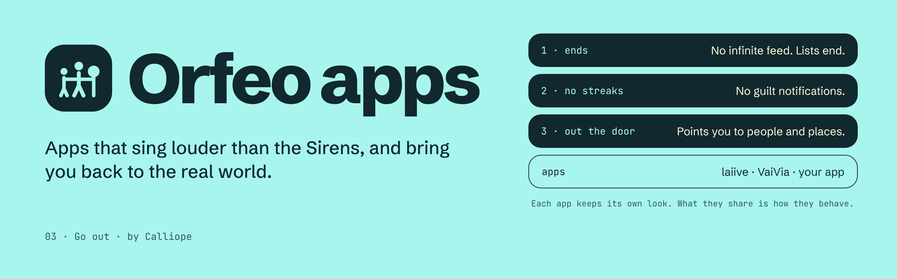

<p align="center">
  
</p>

<!-- Lighter alternative to the banner: the lockup, switching with GitHub's light or dark theme.
<p align="center">
  <picture>
    <source media="(prefers-color-scheme: dark)" srcset="./assets/brand/orfeo-apps-lockup-endorsed-for-dark.svg">
    
  </picture>
</p>
-->

<p align="center"><b>Orfeo apps</b> · 03 Go out · by <a href="https://github.com/[ORG]">Calliope</a></p>

Orfeo apps sing louder than the Sirens, and bring you back to the real world. Each app keeps its own name and look. What they share is how they behave.

Every Orfeo app:

1. **Ends.** No infinite feed. Lists end.
2. **Has no streaks and no guilt notifications.**
3. **Points you out the door**, to people and places.

| App | | |
|---|---|---|
| [**laiive**](https://laiive.com) | Ask what is on tonight. | laiive.com |
| [**VaiVia**](https://vaivia.dev) | Ask for a trail the way you would ask a local. | vaivia.dev |
| **Your app** | Open to any app that follows the Orfeo principles. | [work with us](https://github.com/[ORG]) |

## For an Orfeo app's own README

The badge is optional. Apps never have to use Calliope's colours, fonts or marks.

```html
<a href="https://github.com/[ORG]/orfeo-apps">
  <picture>
    <source media="(prefers-color-scheme: dark)" srcset="https://raw.githubusercontent.com/[ORG]/orfeo-apps/main/badge/badge-orfeo-app-outline-for-dark.svg">
    
  </picture>
</a>
```

Or as plain text in a footer: *An Orfeo app · by Calliope*.
