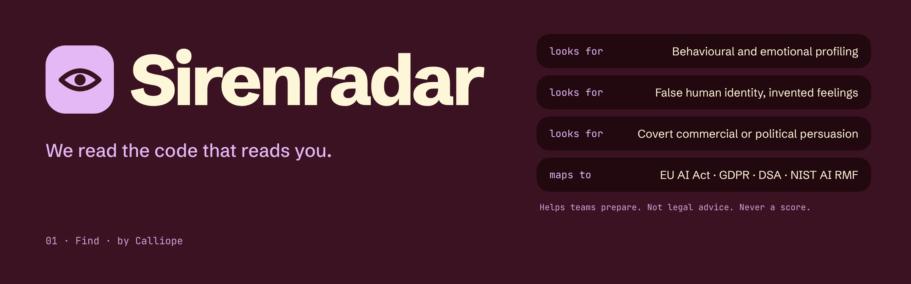
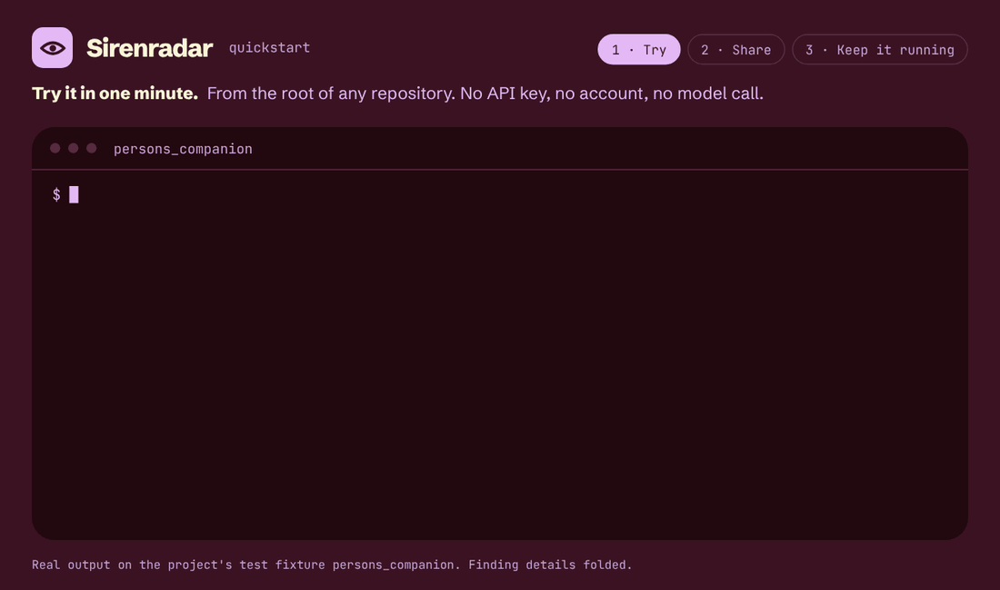
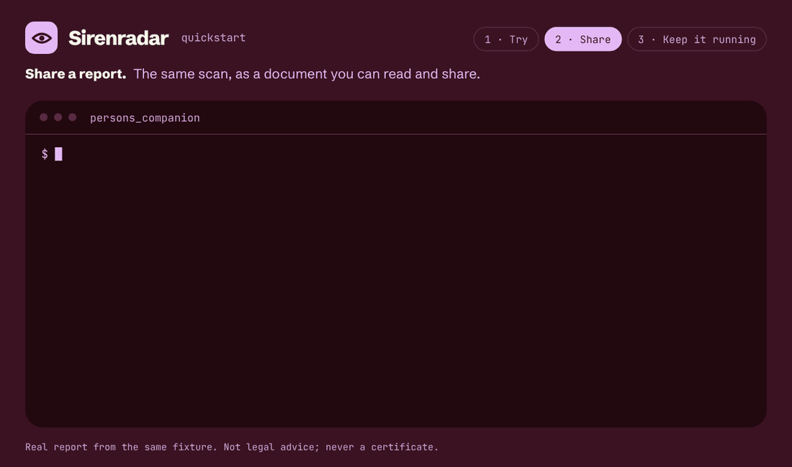
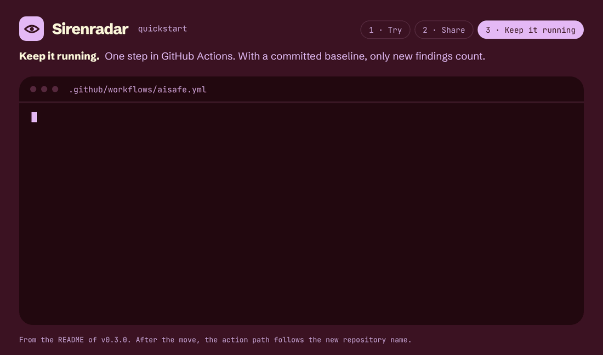

<p align="center">
  
</p>

<!-- Lighter alternative to the banner: the lockup, switching with GitHub's light or dark theme.
<p align="center">
  <picture>
    <source media="(prefers-color-scheme: dark)" srcset="./assets/brand/sirenradar-lockup-endorsed-for-dark.svg">
    
  </picture>
</p>
-->

<p align="center"><b>Sirenradar</b> · 01 Find · by <a href="https://github.com/[ORG]">Calliope</a></p>

Sirenradar reads AI software for the Sirens: behavioural and emotional profiling, false human identity or invented feelings, and covert commercial or political persuasion. Every finding carries its evidence, a decision and a severity.

It helps teams prepare for the EU AI Act, GDPR, the DSA and other AI rules. It is not legal advice, and it never gives a score or a certificate. Absence of a finding is not evidence of safety.

## Start here

### 1 · Try it in one minute

From the root of any repository (you need [uv](https://docs.astral.sh/uv/) for `uvx`). No API key, no account, no model call.

```bash
uvx aisafe audit .
```

<picture>
  <source media="(prefers-reduced-motion: reduce)" srcset="./assets/quickstart/sirenradar-quickstart-1-try.png">
  
</picture>

### 2 · Share a report

```bash
uvx aisafe audit . --format html -o aisafe-report.html
```

<picture>
  <source media="(prefers-reduced-motion: reduce)" srcset="./assets/quickstart/sirenradar-quickstart-2-share.png">
  
</picture>

### 3 · Keep it running

Add `.github/workflows/aisafe.yml`:

```yaml
name: AI influence audit
on: [pull_request, push]
permissions:
  contents: read
  security-events: write   # SARIF upload (on by default)
  pull-requests: write     # only if pr-comment is "true"
jobs:
  aisafe:
    runs-on: ubuntu-latest
    steps:
      - uses: actions/checkout@v4
      - uses: ai-safe-earth/AnyAISafe@v0.3.0
        with:
          fail-on: high
          # optional; commit it first (aisafe audit . --write-baseline audit-baseline.json)
          baseline: audit-baseline.json
          pr-comment: "true"
```

<picture>
  <source media="(prefers-reduced-motion: reduce)" srcset="./assets/quickstart/sirenradar-quickstart-3-keep-running.png">
  
</picture>

<!-- Paste the rest of the existing AnyAISafe README below this line. -->
