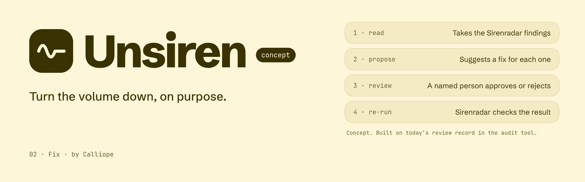

  

<!-- Lighter alternative to the banner: the lockup, switching with GitHub's light or dark theme.

  <picture>
    <source media="(prefers-color-scheme: dark)" srcset="./assets/brand/unsiren-lockup-endorsed-for-dark.svg">
    
  </picture>

-->

<b>Unsiren</b> · 02 Fix · by <a href="https://github.com/[ORG]">Calliope</a> · <i>concept</i>

> Unsiren is a concept. Nothing here is released yet.

Unsiren will propose fixes for what [Sirenradar](https://github.com/[ORG]/sirenradar) finds. A named person reviews every fix, and the review is bound to the file's hash, so a later edit reopens it. Then Sirenradar runs again.

1. **Read**: takes the Sirenradar findings.
2. **Propose**: suggests a fix for each one.
3. **Review**: a named person approves or rejects it.
4. **Re-run**: Sirenradar checks the result.

To find Sirens today, start with [Sirenradar](https://github.com/[ORG]/sirenradar).
