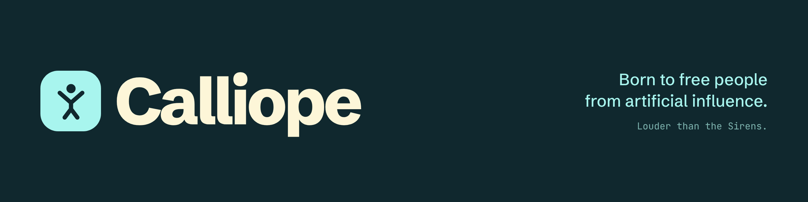
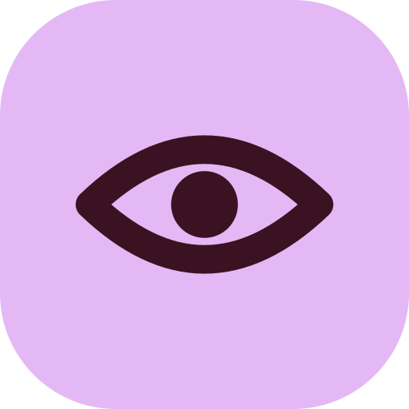
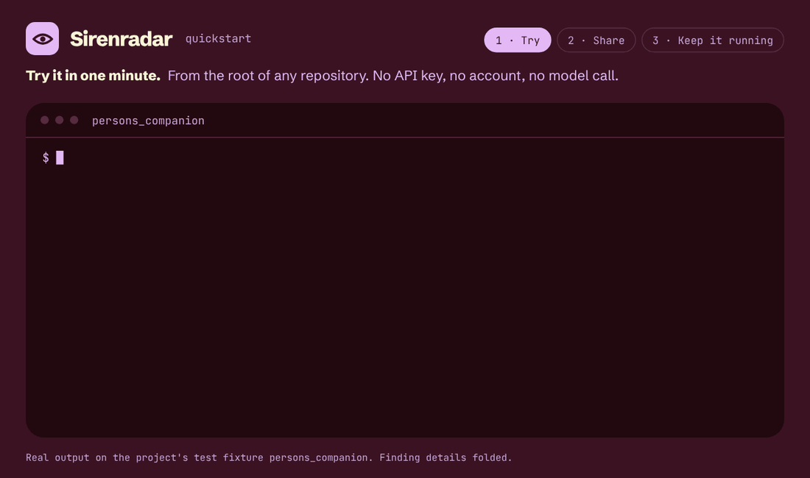
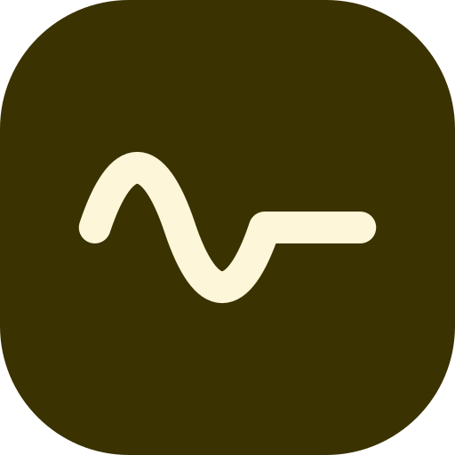
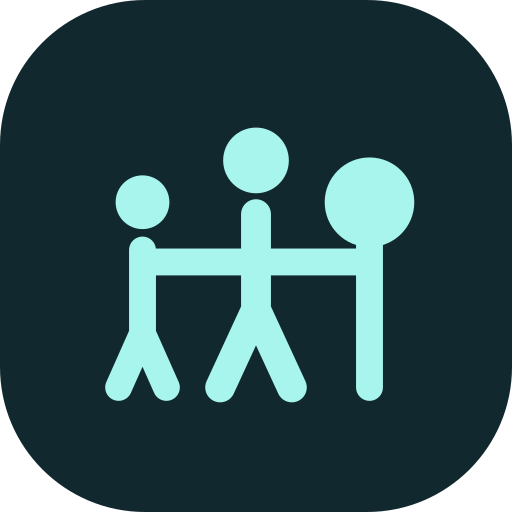

<p align="center">
  
</p>

## Our mission

**Calliope, born to free people from artificial influence.**

## Why

Much of the software we use every day is designed to hold our attention and steer our choices. Feeds that never end, streaks, alerts, recommendations, tracking. We call these techniques **the Sirens**: they pull, quietly, and they are hard to notice from inside.

AI makes the Sirens more personal. A system can now learn what moves you, speak as if it were a person, and persuade without saying so. Now that AI is in the loop, this kind of influence puts people, communities and democracies at risk.

| Figure | What it measures | Source |
|---|---|---|
| **97%** | of popular EU websites and apps show at least one dark pattern | European Commission study, 2022 · [source](https://op.europa.eu/en/publication-detail/-/publication/606365bc-d58b-11ec-a95f-01aa75ed71a1/language-en) |
| **+81%** | higher odds that GPT-4 changed someone's view when it knew a few facts about them, compared with a human | Salvi et al., *Nature Human Behaviour*, 2025 · [source](https://doi.org/10.1038/s41562-025-02194-6) |
| **6h 38m** | average time online per day, for adult internet users worldwide | We Are Social & Meltwater, *Digital 2025* · [source](https://datareportal.com/reports/digital-2025-global-overview-report) |

We don't wait for perfect research or perfect policy. We begin with what we have, and keep tending it: tools that make the Sirens visible, help to remove them, and apps that bring people back to the real world. Calm, open and built to last.

**Find → fix → go out.**

## The software

###  Sirenradar · find

**We read the code that reads you.** Sirenradar scans AI software for the Sirens: behavioural and emotional profiling, false human identity or invented feelings, and covert commercial or political persuasion. Every finding carries its evidence, a decision and a severity, mapped to the EU AI Act, GDPR, the DSA, NIST AI RMF and the OWASP LLM Top 10.

It helps teams prepare for those rules. It is not legal advice, and it never gives a score or a certificate.

```bash
uvx aisafe audit .
```

<picture>
  <source media="(prefers-reduced-motion: reduce)" srcset="https://raw.githubusercontent.com/calliope-mission/.github/main/assets/brand/calliope-github/sirenradar/assets/quickstart/sirenradar-quickstart-1-try.png">
  
</picture>

<sub>Available today as AnyAISafe v0.3.0, so the command is <code>aisafe</code>. Sirenradar is its new name.</sub> · [Repository](https://github.com/ai-safe-earth/AnyAISafe)

### <picture><source media="(prefers-color-scheme: dark)" srcset="https://raw.githubusercontent.com/calliope-mission/.github/main/assets/brand/calliope-brand/logos/unsiren-mark-cream.svg"></picture> Unsiren · fix · *concept*

**Turn the volume down, on purpose.** Unsiren will take what Sirenradar finds and propose a fix for each Siren. A named person approves or rejects every fix, and the review is recorded. Then Sirenradar runs again. Unsiren is in design; nothing is released yet. · [Repository](https://github.com/calliope-mission/unsiren)

### <picture><source media="(prefers-color-scheme: dark)" srcset="https://raw.githubusercontent.com/calliope-mission/.github/main/assets/brand/calliope-brand/logos/orfeo-mark-aqua.svg"></picture> Orfeo apps · go out

In the myth, Orpheus played louder than the Sirens, so the Argonauts could sail past them. Orfeo apps are applications that do the same: they sing louder than the Sirens, and bring you back to the real world.

Each Orfeo app has its own name and look. What they share is how they behave. Every Orfeo app:

- **ends**: no infinite feed;
- **has no streaks** and no guilt notifications;
- **points you out the door**, to people and places.

| App | |
|---|---|
| [**laiive**](https://laiive.com) | Ask what is on tonight. |
| [**VaiVia**](https://vaivia.dev) | Ask for a trail the way you would ask a local. |
| **Your app** | Open to any app that follows these principles. |

## Take part

### Use SirenRadar and Unsiren

Run [Sirenradar](https://github.com/ai-safe-earth/AnyAISafe) on the software you build or buy.

### Use the apps

Try [laiive](https://laiive.com) or [VaiVia](https://vaivia.dev).

### Contribute

We work in three steps:

| Spot | Strategy | Act |
|---|---|---|
| A risk or an opportunity, close to home. | What it needs, and who will carry it. | Make it, hand it over, stay to help. |

Code, research, teaching, translation and design are all welcome. Pick an [open issue in Sirenradar](https://github.com/ai-safe-earth/AnyAISafe/issues), review test cases, or build an app that follows the Orfeo principles. Start at your own pace, and say what you pick so nobody doubles up.

### Get in touch

Write to us, or [open a discussion](https://github.com/orgs/calliope-mission/discussions). Partners who help with funding, expertise, help in kind or pilot towns and schools are welcome.

Everyone around Calliope is part of the **Calliope community**. Its members, we call them Argonauts.
